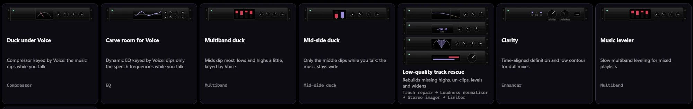
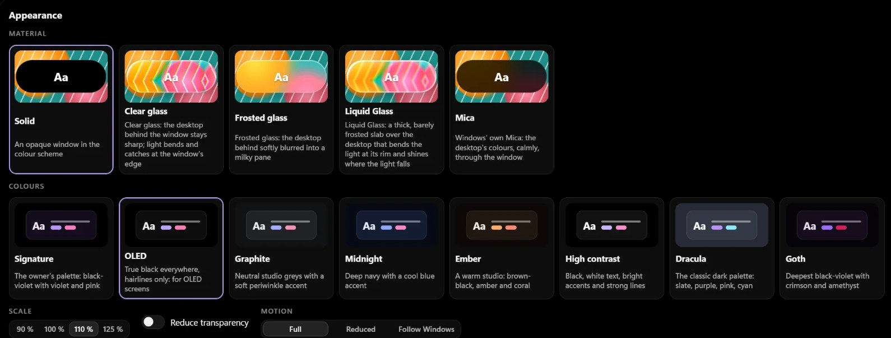

# PULSE

PULSE is a Chrome extension for sharing one browser tab's audio into an X Space. You need desktop Chrome 120 or later and host or speaker access in the Space.

**[Download PULSE 1.0.6](https://github.com/quiet-runtime/pulse/releases/download/v1.0.6/pulse-1.0.6-chrome.zip)** · [Release notes](https://github.com/quiet-runtime/pulse/releases/tag/v1.0.6) · [Support](https://github.com/quiet-runtime/pulse/issues) · [Privacy](PRIVACY.md)

PULSE is free to use. PULSATE and PULSAR are separate products in development.

## Controls

<table>
<tr>
<td width="30%" align="center" valign="top"> PULSE interface with sample media.</td>
<td width="70%" valign="top">

| Control | Function |
| --- | --- |
| **Share a tab** | Opens Chrome's picker to choose the audio source. |
| **Level** | Adjusts tab audio. The meter shows the signal after the fader. |
| **Width** | Narrows to mono at −100, leaves width unchanged at 0, and widens it above 0. |
| **Voice** | Includes or excludes your microphone from the shared mix. Starts off. |
| **M** | Silences the outgoing tab. With player access, it also mutes the source player. |
| **Player buttons** | Control a compatible source player. Previous/next depend on the website; seeking requires a known duration. |
| **Stop** | Ends sharing and restores X's microphone connection. |

</td>
</tr>
</table>

**X's mute also silences shared audio.** Unmute in X to send the tab audio. Voice controls whether your microphone joins that mix.

A normal Stop with Voice off mutes X before restoring its microphone. A crash or connection stall can return to X's normal microphone behavior. The On air indicator shows browser-side transmission, rather than confirmation of what each listener hears.

## Installation

1. Download **pulse-1.0.6-chrome.zip** using the link above.
2. Extract it into a folder you will keep on your computer.
3. Open `chrome://extensions`, enable **Developer mode**, choose **Load unpacked**, and select the extracted folder containing `manifest.json`.
4. Open X after installation. If X was already open, refresh that page when you are outside an active Space.
5. Enter a Space as a host or speaker. Start audio in the source tab.
6. Press **Share a tab** in PULSE. Select the source under **Chrome Tab**, enable **Also share tab audio**, and press **Share**.
7. Unmute in X. Enable **Voice** if you want to speak over the tab audio.

Use the named extension ZIP. GitHub's automatic Source code archives are not installable Chrome extensions.

Updates are manual: replace the extracted files with the new version, reload PULSE in `chrome://extensions`, then refresh X outside an active Space.

## Limitations

- **Player selection:** when Chrome does not identify the captured tab, player controls fall back to detecting an audible tab. With several audible tabs, controls can target the wrong one. Pause other audible tabs before sharing. After first granting player access, stop and share again.
- **Website compatibility:** some players cannot be controlled. Previous may restart the current item, Next may be unavailable, and live streams cannot be seeked.
- **Delivery:** PULSE supports stereo transmission, but X and the listener's app determine what reaches the listener. A displayed bitrate is not a fixed delivery guarantee.
- **Compatibility:** this package targets desktop Chrome. X or browser changes can affect operation.

## Permissions and privacy

| Access | Purpose |
| --- | --- |
| Local extension storage | Saves level, Width and panel position on this device. |
| Content scripts on x.com and twitter.com | Shows the panel and connects to the Space's browser audio connection. |
| Optional scripting and all-sites access | Lets player controls reach source players and helps identify the shared tab. Requested at first use of those controls or M. |
| Chrome's sharing picker | Lets you choose a tab for each share. |

The optional permission covers more than the selected tab. PULSE can inspect candidate audible tabs to identify a player. You may decline this access and still share audio, but source-player controls will be unavailable.

PULSE does not record audio or send developer analytics. Shared audio travels through X's existing Space connection. [Privacy details](PRIVACY.md).

## Related products

| | PULSE | PULSATE | PULSAR |
| --- | --- | --- | --- |
| **Form** | Chrome extension | Chrome extension | Desktop app |
| **Purpose** | Share one tab | Mix several sources | Room view, mixer and turntables |
| **Controls** | Level, Width, Voice and compatible player controls | Channel processing and a built-in player | Channel processing, racks, turntables and MIDI |
| **MIDI mapping** | No | No | In the desktop development build |
| **Status** | Version 1.0.6 available | In development | Windows in development; macOS planned |

### PULSATE

PULSATE is a Chrome extension in development for mixing several sources into one Space. It includes channel processing, a built-in player, loudness controls, themes and interface scaling. It does not support MIDI mapping and is not included in the PULSE ZIP. Features may change before release.

### PULSAR

PULSAR is a desktop app in development, with Windows first and macOS planned. Its development build includes a Room view, multiple Feeds, two turntables, channel processing, effects racks, MIDI mapping, recording controls and session records. Application capture currently requires Windows 11.

 Development build with sample tracks.

More PULSAR screenshots

## Support and terms

Report problems through [GitHub Issues](https://github.com/quiet-runtime/pulse/issues). Include your operating system, Chrome version, source website and the steps that produced the problem.

[Repository licence](LICENSE.md) · [Privacy](PRIVACY.md)

The extension ZIP contains its usage terms in `LICENSE.txt` and dependency notices in `THIRD_PARTY_NOTICES.txt`.

PULSE, PULSATE and PULSAR are independent products, not affiliated with X Corp. Promotional banners are illustrations; interface images show the product or development build described in their captions.
