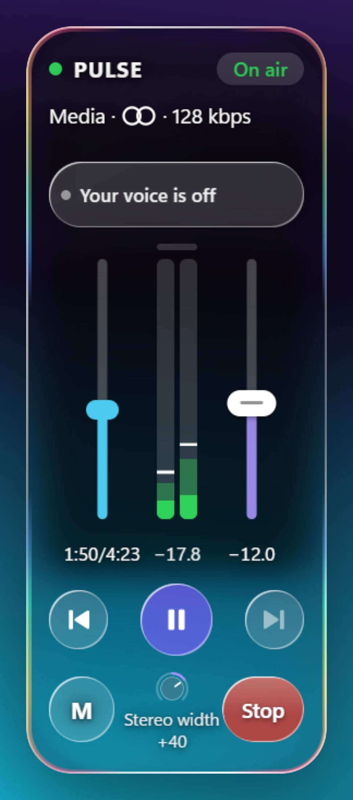
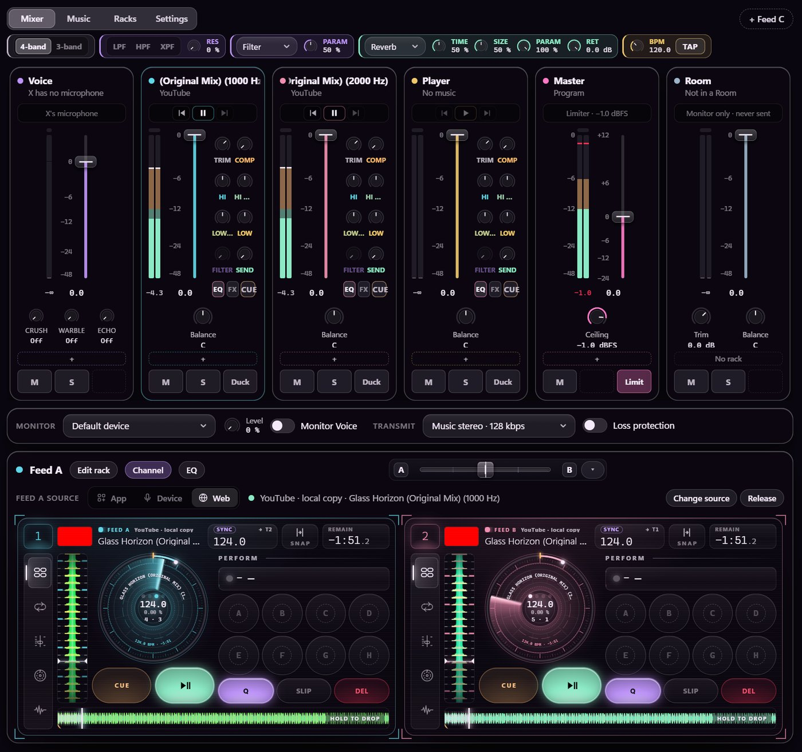
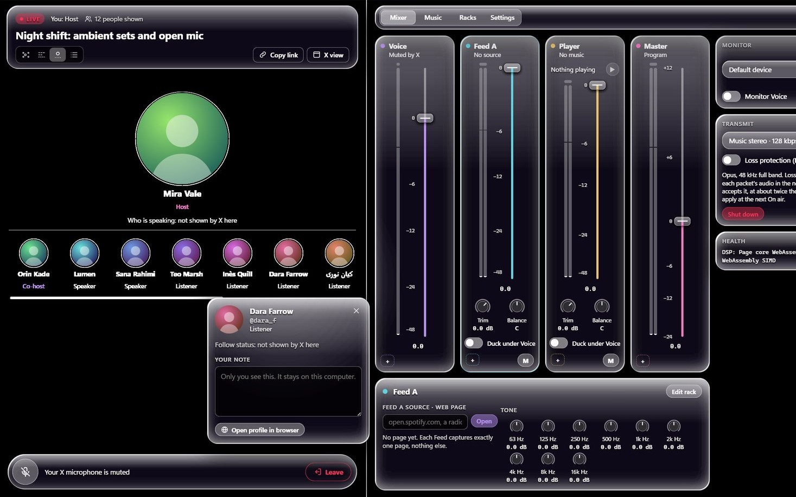
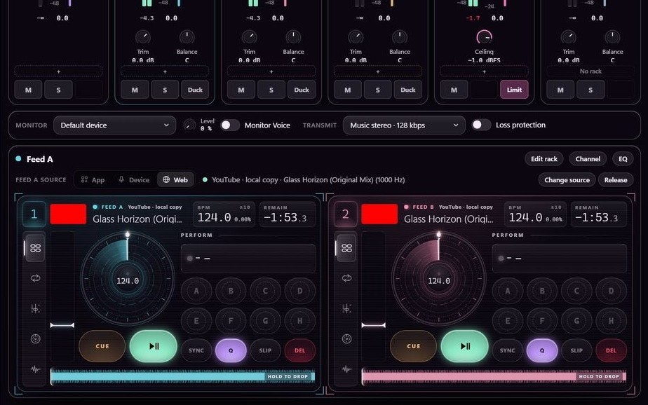
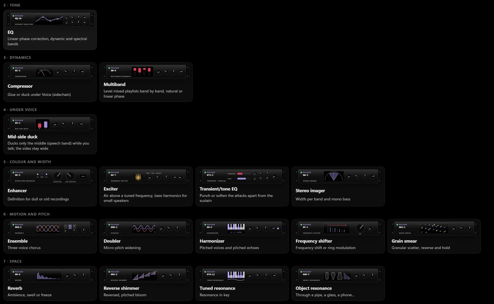
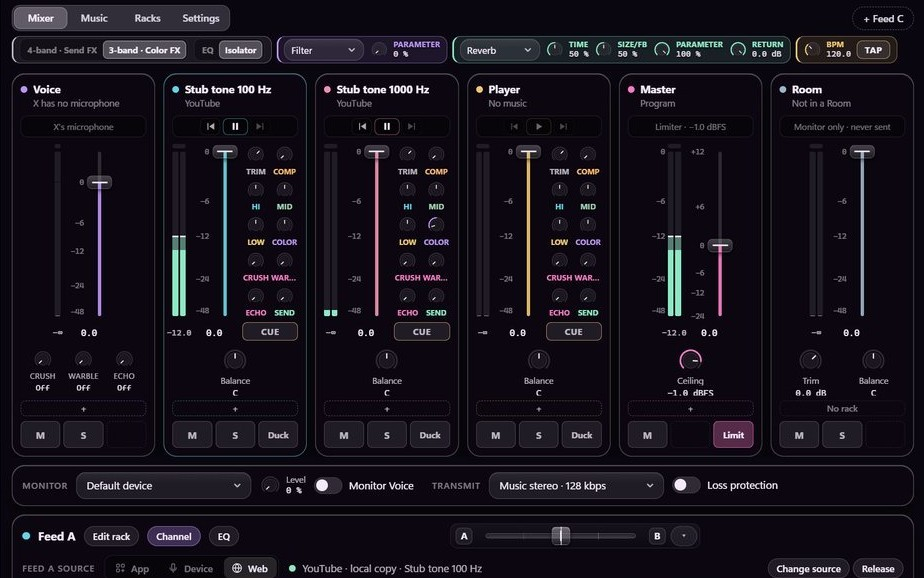
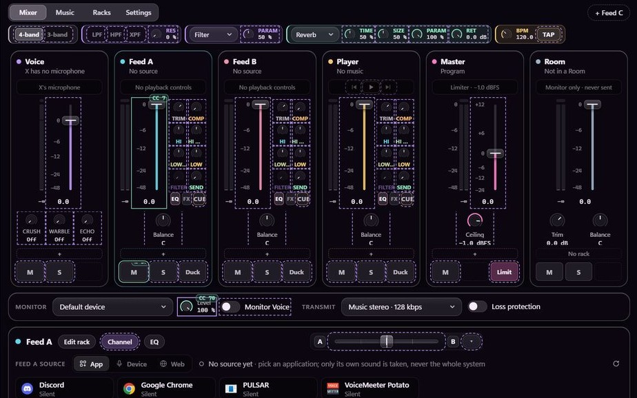
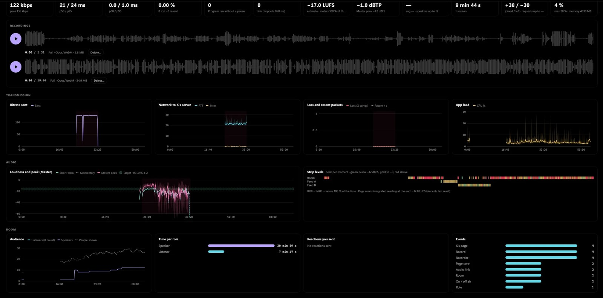

<h1 align="center">PULSE · PULSATE · PULSAR</h1>

<b>Full-band stereo for X Spaces.</b> 
From one strip in Chrome to a full console on Windows and macOS.

<a href="../../releases/latest"><b>Download PULSE 1.0.5</b></a> · <a href="#pulsate">PULSATE</a> · <a href="#pulsar">PULSAR is coming to Windows and macOS</a>

<table>
<tr>
<th width="24%">PULSE</th>
<th width="26%">PULSATE</th>
<th width="50%">PULSAR</th>
</tr>
<tr>
<td align="center"></td>
<td align="center"><b>Many channels. A few good knobs. A built-in player.</b></td>
<td align="center"></td>
</tr>
<tr>
<td>One strip, one tab, and your mic stays out unless you let it in.</td>
<td>The full extension: multi-channel, with effects and a built-in player.</td>
<td>The whole console on your computer, with your own Room view.</td>
</tr>
<tr>
<td><b>Chrome</b> Version 1.0.5</td>
<td><b>Chrome</b> In the works</td>
<td><b>Windows, macOS</b> Coming</td>
</tr>
</table>

The website in this repository runs the real PULSAR Studio in your browser: its Mixer, Turntables, Racks and audio engine, with AI-made sample music and voices.

---

## PULSE

**Share a tab's audio into your Space, in stereo.** That is the whole job, so PULSE stays one strip.

- **Share a tab.** Chrome's own picker asks which tab, and the audio joins the connection X already opened for your Space.
- **Run its player.** Previous, play, pause, next and a time bar, right on the strip.
- **Ride the level.** The fader sets the tab's volume; the meter shows the signal as it leaves the fader.
- **Open up the stereo.** The Width knob runs from mono at −100 to wider at +100, and is off at 0.
- **Mute with one key.** M takes the tab off the air and mutes it in the tab too.
- **Your microphone stays out.** Only the tab goes out, until you press the Voice key to talk over it.
- **Know when you're live.** On air shows only once the audio is really leaving your browser. Stop gives X its microphone back.

### Get started

1. Download the zip from [Releases](../../releases/latest) and unzip it.
2. In Chrome, open `chrome://extensions`, turn on Developer mode and choose **Load unpacked**.
3. Go on stage in a Space as a host or speaker. The strip appears at the bottom left.
4. Press **Share a tab** and choose the tab in Chrome's picker.

Unmute in X to go on air. A mute in X, yours or a host's, silences everything you send, tab included. PULSE sends full-band stereo; what each listener's X app plays is up to X.

---

## PULSATE

**The full extension, in the works.** PULSE shares one tab. PULSATE gives you several channels to mix, in Chrome, right beside your Space.

- **Multi-channel.** Bring in more than one source and balance them against each other.
- **A few knobs that matter.** The controls you reach for during a Space, with no manual needed.
- **Effects.** Shape your sound from inside the extension.
- **A built-in player.** Load your own music and play it from PULSATE, with no extra tab.
- **Small comforts.** Quality-of-life touches that keep a Space running smoothly.

PULSATE is a build of its own and is not finished, so the details may change.

---

## PULSAR

**PULSE is one channel. PULSAR is the whole console.** Coming to Windows and macOS.

 
PULSAR's Studio in a test build, two test tracks in sync.

<table>
<tr>
<td width="50%"></td>
<td width="50%"></td>
</tr>
<tr>
<td><b>Your own Room view.</b> Sign in on X's own page, inside the app. Create and schedule Spaces, see the stage, handle requests to speak, and react.</td>
<td><b>Turntables that perform.</b> Two of them: three-band waveforms, CUE, eight hot cues, loops, beat jump, tempo that keeps the key, key shift, beat sync, jog and a crossfader.</td>
</tr>
<tr>
<td></td>
<td></td>
</tr>
<tr>
<td><b>Racks of effects.</b> 39 processors: reverb in 14 spaces on an 8-line FDN, echoes, modulation, filters, lo-fi units, and a linear-phase multiband.</td>
<td><b>A real channel section.</b> Trim, compressor, 4-band EQ or 3-band isolator, filter or colour effects, and send effects with a shared return.</td>
</tr>
<tr>
<td></td>
<td></td>
</tr>
<tr>
<td><b>MIDI on the controls.</b> Learn, pickup, 14-bit controllers, relative encoders and feedback.</td>
<td><b>A record of every Space.</b> Bitrate, network, loss, loudness and audience over time, with REC keeping what you heard and what you sent.</td>
</tr>
</table>

- **Any source, isolated.** A desktop app, an audio device, a web page, YouTube or a local file, each on one of six Feeds, with crosstalk held to −100 dBFS.
- **It reads the music.** Beat This! beat grids, downbeats, S-KEY musical key and song sections, worked out on your own machine.
- **Clean at full scale.** An 826-run audit of the channel section at 0 dBFS found every path at or under 0.0 dBFS.

**Want it first?** Press **Watch** on this repository and choose **Custom → Releases**.

## Engineering, in brief

- **Transmit:** Opus (RFC 7587), 48 kHz stereo, 128 kbps by default, `usedtx=0`, `cbr=0`. Only the Opus `fmtp` line changes, and only on connections that send audio.
- **No lossy hop** before X's encoder. Sources are mixed at 48 kHz in 32-bit float and cross between contexts on the audio threads.
- **Loudness:** ITU-R BS.1770-4 and EBU R128. **Limiter:** true peak at 8× oversampling.
- **Claims come from measurements:** On air, stereo and bitrate are read from the sender's own statistics, and quality is measured at the receiving side of a loopback peer.

## Privacy

PULSE has no servers, no accounts and no analytics, and records nothing. It stores its settings and runs on x.com and twitter.com; the player keys and M ask once for access to the tab you share. Read the [privacy policy](PRIVACY.md).

PULSE, PULSATE and PULSAR are independent products. Not affiliated with or endorsed by X Corp.
