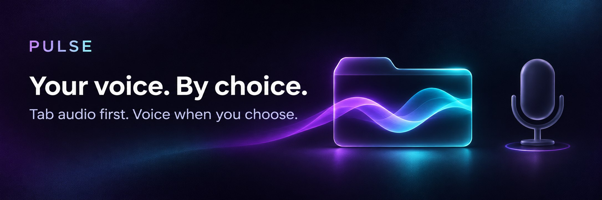

  

<h1 align="center">PULSE for X Spaces</h1>

<b>Bring your tab to the conversation.</b> 
Share music, a video or a clip from one browser tab. 
Your microphone joins the shared mix only when you choose.

  <a href="https://github.com/quiet-runtime/pulse/releases/download/v1.0.6/pulse-1.0.6-chrome.zip"><b>Download PULSE 1.0.6</b></a>
  &nbsp;·&nbsp; <a href="#install-pulse">Install</a>
  &nbsp;·&nbsp; <a href="#permissions-and-privacy">Permissions &amp; privacy</a>
  &nbsp;·&nbsp; <a href="https://github.com/quiet-runtime/pulse/issues">Support</a>

<b>Available now · Free to use · Desktop Chrome 120+</b> 
PULSE is the extension in this download. PULSATE and PULSAR are separate products in development.

## One strip. One tab.

PULSE gives hosts and speakers a compact audio strip over X. Choose a tab, set its level, and share its sound through your Space's existing audio connection.

<table>
<tr>
<td width="30%" align="center" valign="top">
 
The PULSE interface with sample media.
</td>
<td width="70%" valign="top">

### Music and clips, right in the room

- **Share one tab.** Chrome's own picker lets you choose the source.
- **Set the level.** A fader controls the tab audio; the meter shows its signal after the fader.
- **Shape the stereo.** Width narrows to mono at −100, leaves width unchanged at 0, and widens it above 0.
- **Control compatible players.** Play/pause and a position bar live on the strip, with previous/next where the website supports them.
- **Choose when to speak.** Voice starts off. Enable it when you want your microphone in the shared mix.
- **Stop from the strip.** End the share and return the connection to X's microphone.

</td>
</tr>
</table>

PULSE supports stereo transmission. What listeners receive also depends on X's connection, servers and listening apps.

### Your voice and X's mute

**Voice** controls whether your microphone joins the shared mix. **M** silences the outgoing tab; with optional player access, it also mutes the source player.

**X's own mute covers everything you send.** If you mute in X, or a host mutes you, the shared tab is silenced too. Unmute in X to send tab audio.

A normal **Stop** with Voice off mutes X before restoring its microphone connection. If PULSE is interrupted by a crash or connection stall, recovery can return to X's normal microphone behavior.

## Install PULSE

You need **desktop Chrome 120 or later** and an X account with permission to speak in the Space. This release is an unpacked Chrome extension.

1. Download [**pulse-1.0.6-chrome.zip**](https://github.com/quiet-runtime/pulse/releases/download/v1.0.6/pulse-1.0.6-chrome.zip).
2. Extract it into a folder you will keep on your computer.
3. Open `chrome://extensions`, turn on **Developer mode**, and choose **Load unpacked**. Select the extracted folder containing `manifest.json`.
4. Open X after installation. If X was already open, reload that page **outside an active Space**, then enter a Space as a host or speaker.
5. Start audio in the source tab. In PULSE, press **Share a tab**. Choose the source under **Chrome Tab**, enable **Also share tab audio**, and press **Share**. Choose the source tab rather than the X tab itself.
6. Unmute in X to send the audio. Enable **Voice** only when you want to speak over it.

**Choose the named extension ZIP.** GitHub's automatic **Source code** archives contain this website repository; they are not an installable PULSE extension.

<b>Player controls, updates and troubleshooting</b>

### Player controls

Sharing audio and controlling a website's player are separate functions. Player controls require optional access and a compatible audio or video player.

- **Previous/next** depend on the website's player. Previous may restart the current item; Next can be unavailable.
- **Seeking** requires a known duration. Live streams cannot be seeked.
- Some players cannot be controlled, even when their audio can be shared.
- **Source identification has a fallback:** if Chrome does not identify the captured tab, PULSE detects an audible tab. With several audible tabs, controls can target the wrong one. Pause other audible tabs before sharing; after granting player access for the first time, stop and share again.

### Manual updates

Download the new version and replace the files in your existing extracted folder. Reload PULSE in `chrome://extensions`, then refresh X when you are outside an active Space. This unpacked installation does not provide Chrome Web Store automatic updates.

### If something does not work

- **No tab audio:** check **Also share tab audio** in Chrome's picker, source playback, PULSE's level and M, and your mute state in X.
- **No strip:** confirm PULSE is enabled and the X page was opened or refreshed after installation. The toolbar button shows or hides the panel.
- **Player buttons do not work:** check optional site access and whether the website exposes a compatible player.
- **Still stuck:** [open an issue](https://github.com/quiet-runtime/pulse/issues) with your operating system, Chrome version, source website and what happened.

> **Player-control limitation:** when the captured tab cannot be identified, controls may select another audible tab. Pause other audible tabs before sharing. This fallback does not change which tab Chrome captures.

## Permissions and privacy

| Access | Purpose |
| --- | --- |
| Local extension storage | Remembers the tab level, Width setting and panel position on this device. |
| Content scripts on **x.com** and **twitter.com** | Shows the strip and connects tab audio to the Space's existing browser audio connection. |
| Optional **scripting** and **all-sites access** | Lets player controls reach a source on any website and helps identify the shared tab. Chrome requests this when you first use those controls or M. |
| Chrome's sharing picker | Lets you choose the tab for each share. |

The optional player permission is broader than access to one selected tab. You may decline it and still share audio; PULSE then cannot operate the source player.

PULSE has no developer-operated audio server, analytics or separate account. It does not record your audio. Shared audio travels through **X's existing Space connection**, so X's policies apply.

[Read the PULSE privacy policy](PRIVACY.md) · [Report a problem](https://github.com/quiet-runtime/pulse/issues)

---

## Choose your setup

| | **PULSE** | **PULSATE** | **PULSAR** |
| --- | --- | --- | --- |
| **Purpose** | One tab, one compact strip | A multichannel mixer in a Chrome extension | A desktop console and Room view |
| **Runs in** | Desktop Chrome extension | Desktop Chrome extension | Windows first; macOS planned |
| **Controls** | Level, Width, Voice and compatible player controls | Channel processing and a built-in player | Turntables, channel processing, effects racks, MIDI and Space records |
| **Availability** | **[Download 1.0.6](https://github.com/quiet-runtime/pulse/releases/tag/v1.0.6)** | **In development** | **In development** |

## PULSATE

**More sources, with a channel strip for each.**

PULSATE is a separate **Chrome extension** in development, with a multichannel mixer for X Spaces. Its design brings several sources into one stereo mix for a Space, with trim, compression, EQ, filtering, effects sends, mute, solo and ducking.

A built-in player, loudness controls, themes and interface scaling are part of the development build. **PULSATE does not support MIDI mapping.** Features may change before release. **PULSATE is not included in the PULSE download.**

## PULSAR

**A desktop console for shaping the sound of your Space.**

PULSAR is in development for **Windows first**, with **macOS planned**. It brings a Room view, two turntables, multiple Feeds, channel processing, effects racks and MIDI control into one app. It is a separate product and is not included in the PULSE download.

 
Actual PULSAR interface from a development build, with sample tracks. Features and appearance may change.

| **Mix and perform** | **Shape and control** |
| --- | --- |
| Two turntables, waveforms, cue points, loops, beat jump, sync, key shift and a crossfader. | Channel EQ, compression, filters and sends, with processor racks and ready-made presets. |
| Sources include files, audio devices, web pages and supported desktop applications. App capture currently requires Windows 11. | MIDI learn, multiple controllers, soft takeover, feedback and mappings you can export and import. |
| A Room view for the stage and speaking requests. | Themes, interface scaling and reduced motion, plus recording controls and Space session records. |

The website files in this repository include a browser demonstration of PULSAR's Studio and audio engine. Its sample music, voices and Room are demonstrations; it does not demonstrate a connection to a live X Space.

<b>Explore the PULSAR development gallery</b>

### The channel section

The channel section offers a 4-band EQ or 3-band isolator, compression, filtering or colour effects, and a send to shared effects. Voice has additional effects of its own. Room is for monitoring, rather than part of the outgoing mix.

### Room and turntables

<table>
<tr>
<td width="50%"></td>
<td width="50%"></td>
</tr>
</table>

### Racks and presets

Build chains on individual strips, or start with presets for voice, music and Master. The development build also includes local beat, key and song-section analysis.

### MIDI and appearance

<table>
<tr>
<td width="50%"></td>
<td width="50%"></td>
</tr>
</table>

### Space records

Session records bring together available network statistics, loudness, audience history and time per role. Recording controls are part of PULSAR; **PULSE does not record audio**.

**Follow development:** use **Watch → Custom → Releases** on this repository for release notifications.

---

## Audio engineering

| Area | What it means |
| --- | --- |
| **PULSE's audio path** | Stereo audio is processed at a 48 kHz working rate in 32-bit float, without an additional lossy encoding step before X's encoder. |
| **Default Opus profile** | Stereo is requested, with a maximum average bitrate of 128 kbps, variable bitrate and DTX disabled. Actual transmission depends on negotiation and conditions. |
| **Master ceiling** | The default Master uses a stereo-linked **sample-peak** ceiling limiter. |
| **PULSAR's metering and rack limiter** | Loudness metering follows ITU-R BS.1770-4 / EBU R128. True-peak measurement and the separate true-peak rack limiter use 8× oversampling. |
| **Transmission status** | On air reflects browser-side sending activity. The stereo label reflects negotiated parameters and local track settings; it is not confirmation of every listener's playback. |

X controls the delivery path after the browser. No fixed listener latency, bitrate or stereo playback is guaranteed here. Controlled loopback results and browser-side status should be read separately from live delivery through X.

## Licence and support

**PULSE is free to use under its proprietary licence.** It is not open-source software. The download contains `LICENSE.txt` and `THIRD_PARTY_NOTICES.txt`; third-party components keep their own licences.

The text, images and code in this repository are covered by [the repository licence](LICENSE.md). The three wide promotional banners are AI-generated brand artwork; interface screenshots are shown separately.

[Download PULSE](https://github.com/quiet-runtime/pulse/releases/tag/v1.0.6) · [Get help or report a problem](https://github.com/quiet-runtime/pulse/issues) · [PULSE privacy policy](PRIVACY.md)

PULSE, PULSATE and PULSAR are independent products. Not affiliated with or endorsed by X Corp.
